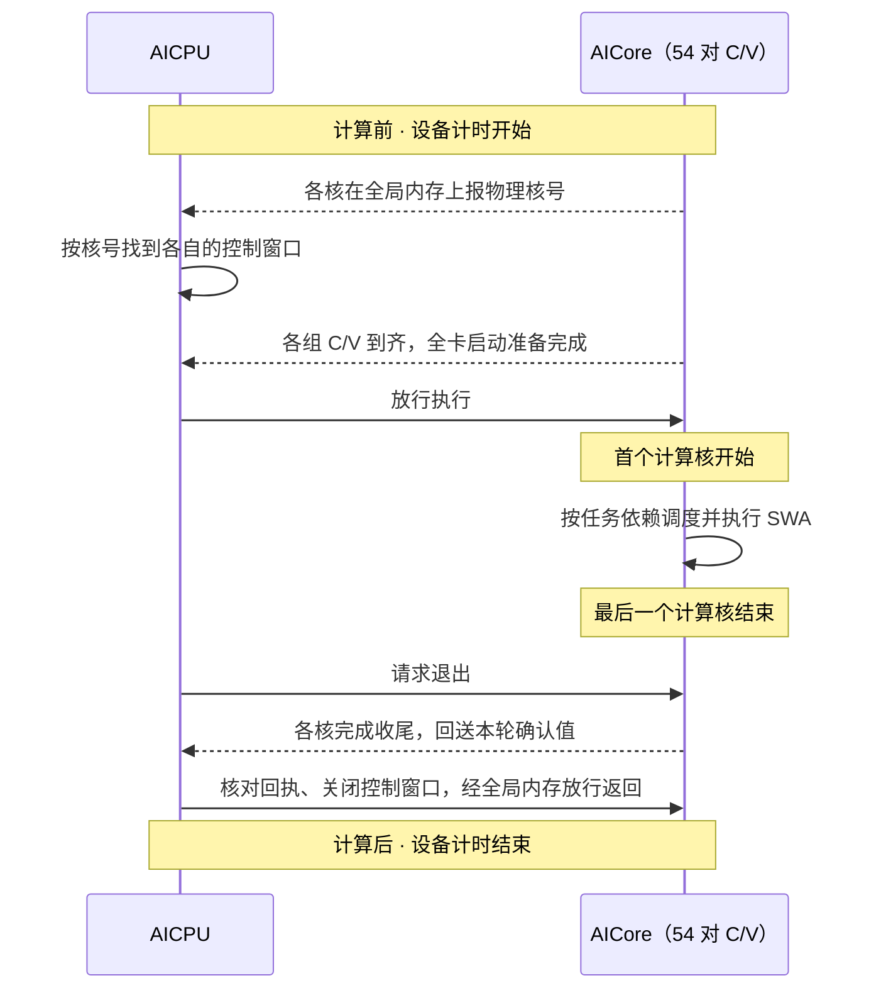

# DSv4.1 单卡 SWA 的 A6 迁移结果

本文记录 00–004 所用的 SWA 图、夹具与命令。005 的任务编号、分片和运行方法见[使用方法](usage.zh-CN.md)及[005 报告](../results/005-swa-a5-baseline-a6-timeouts/README.zh-CN.md)。

这次迁移选取了 DSv4.1 解码阶段的滑动窗口注意力子层（SWA）。它可以在一张卡上独立回放，又包含矩阵核和向量核协同执行的 Attention 与输出投影，适合检验 A5 的算子分工和调度方式迁到 A6 后，能否正确完成同一段模型计算。

**截至 2026-11-19，SWA 已在 A6 上通过生产 HBG 的单卡验证。** Host 建图后，AICPU 完成核握手，AICore 调度并执行全部 16 个计算任务，最后各核正常退出。A5、A6 使用同一份固定输入，两端的 30 个可写缓冲区均与参考输出逐字节一致。

## 已完成的适配

| 适配项 | 改了什么，验证到哪里 |
| ------ | -------------------- |
| 单卡用例与构建 | 从双卡完整推理中提取 SWA，固定任务图、输入和参考输出。用 CANN 和 PTO-ISA 直接编译 19 个 C++ 核，接通 A6 的 Host、AICPU、AICore 运行时。单卡可独立复测，无需重新运行 PyPTO／PTOAS。 |
| 核编号与控制窗口 | 按设备上报的物理核号建立控制通道。迁移基线的 108 个 worker 全部完成报到。 |
| 启动放行与退出回执 | AICPU 向各核放行计算，并在退出时核对每个核的确认值。修正核侧回执接口后，整图可正常返回。 |
| 组内同步与共享缓冲区 | 按 1C1V 的成员数判断到齐，并调整共享调度区以避开已有工作区。组内双向握手通过。 |
| Attention 与输出投影 | Attention 将 24 个 1C2V block 拆成 48 个 1C1V block，每组处理 32 个注意力头。输出投影保留 32 个 block，每组原由两个 V 各处理 128 列，A6 改由一个 V 分两次完成 256 列。 |
| 任务回放与核调用 | 回放计划仅调整上述两处 MIX 分片。16 个计算任务的依赖保持一致，A5 展开 578 个执行实例，A6 展开 570 个。两端均由生产 HBG 装载并调用各自编译的计算核。 |
| 计时与泳道 | 核实 A6 设备计数器约为 1 GHz，适配 1C1V 泳道，并按核执行身份还原核名。两端均取得 L0 设备耗时、L1 逐核时长和 L3 AICPU 启动及收尾拆解。 |

**A6 单卡执行时序。** 图中右侧代表全卡 54 对矩阵核和向量核。寄存器按核访问，时间从上向下。

## 单卡性能对照

单卡预热 1 轮，取 10 个正式轮次的均值，耗时单位为 **µs**。A5 使用 32C／64V，A6 使用 54C／54V。前两行对照适配前后的 A5，后两行对照同一用例在 A5、A6 上的表现。

- **L0 从左到右读。** “计算前”从 AICPU 本轮设备计时开始到首个计算核开始。**AICore wall** 从首核开始到末核结束，包含核之间的空隙。“计算后”从末核结束到设备计时结束。三段相加即 **Device wall**，Host 建图耗时另计。
- **末两列衡量距理论下界的差距。** 下界用 L1 逐核实测时长、依赖关系、同步启动约束和可用核数，在调度开销设为零时求得。“实测高于下界”按 `(AICore wall ÷ 下界 − 1) × 100%` 计算。A5 迁移前沿用历史 L1 下界，两个迁移版使用各自的 L1 复测值。

| 平台与用例 | 计算前 | AICore wall（L0） | 计算后 | Device wall（L0） | 同步约束理论下界（L1 推算） | 实测高于下界 |
| ---------- | -----: | ----------------: | -----: | ----------------: | --------------------------: | -----------: |
| A5 迁移前 | 61.411 | 269.698 | 43.239 | 374.347 | 134.880 | 99.95% |
| A5 迁移版 | 59.971 | **269.286** | 42.552 | **371.809** | **133.030** | 102.43% |
| A6 迁移版 | 55.616 | **370.307** | 37.236 | **463.159** | **212.200** | 74.51% |

- **A5 回归。** 迁移前后在同一张 A5 卡上复测，核窗口均值相差 0.412 µs（0.15%）。
- **逐核观测。** Attention 拆分后，两组各自读取完整 KV。该任务占全用例新增累计核时的 49.1%。这里按各核执行时长求和，并行区间会重叠。

## AICPU 在计算前后花了多少时间

两列数值是 A5、A6 **开启 L3 详细打点时**的十轮均值。AICPU 同一阶段的多个线程并行时，重叠时间只计一次。“其中”各行是上方合计的子项。打点和汇总本身会增加耗时，跨平台性能取上表 L0。

| L3 阶段 | 统计范围 | A5 迁移版（µs） | A6 迁移版（µs） |
| ------- | -------- | --------------: | --------------: |
| **计算前合计** | 设备计时开始到首核开始，含准备与等待 | **217.966** | **177.689** |
| 其中，泳道初始化 | AICPU 准备本轮泳道采集 | 138.150 | 96.375 |
| 其中，核握手 | AICPU 等待并确认各核报到 | 10.145 | 7.889 |
| 其中，启动准备等待（bootstrap） | AICPU 等待全卡各组就绪 | 43.192 | 58.366 |
| **AICore wall** | 首个计算核开始到最后一个计算核结束 | **417.925** | **666.058** |
| **计算后合计** | 末核结束到设备计时结束，含退出与采集收尾 | **538.794** | **355.150** |
| 其中，等待核退出 | AICPU 等待各核完成退出协议 | 47.255 | 59.820 |
| 其中，汇总泳道记录 | AICPU 收集本轮设备上的泳道记录 | 442.250 | 263.699 |
| **Device wall** | 计算前合计 ＋ AICore wall ＋ 计算后合计 | **1174.684** | **1198.896** |

## 迁移结论

同一份 SWA 任务图已经可以在 A5 的 1C2V 和 A6 的 1C1V 上独立回放。迁移覆盖了两处协同计算的重新分工，也验证了 A6 从逐核启动到退出回执的完整控制流程。

**两端的设备耗时差距集中在首个计算核启动到最后一个计算核结束之间。** 按 L0 计时，A6 在这段多用 **101.021 µs**，计算前后两段合计少用 **9.671 µs**，整次设备执行净增 **91.350 µs**。将调度开销设为零后，A6 的最短排程仍比 A5 长 **79.170 µs**，说明分片后的核体时长、依赖和可用核数已经显著影响了这段 SWA 的耗时。
